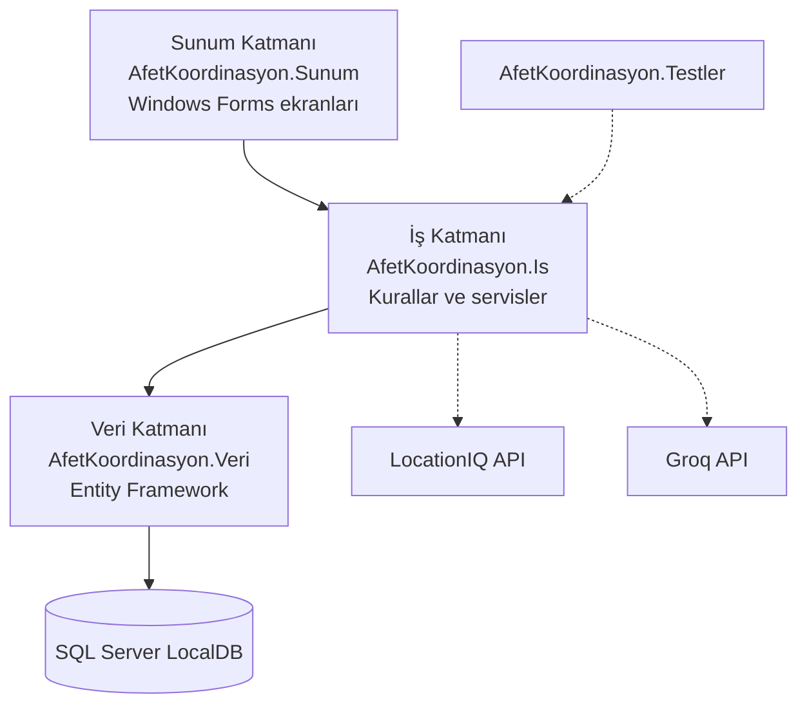
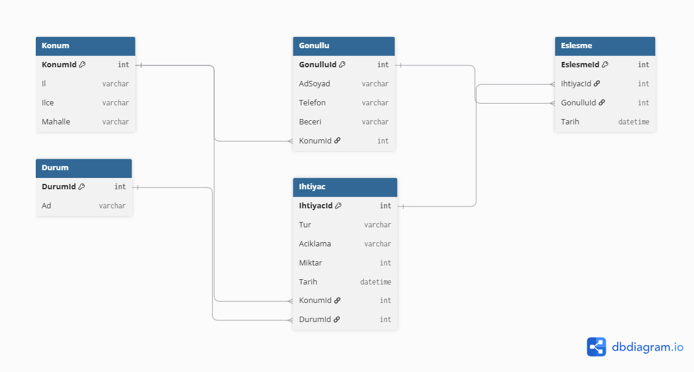

# Afet Sonrası İhtiyaç ve Gönüllü Koordinasyon Sistemi

**P13 · Afet Yönetimi Grubu** · Bilgisayar Uygulamaları I · Bingöl Üniversitesi
Geliştirici: Beyzanur Rana Sansar

Afet sonrasında ihtiyaçların konum bilgisiyle toplanmasını, bu ihtiyaçların uygun gönüllülerle eşleştirilmesini ve her ihtiyacın durumunun takip edilmesini sağlayan Windows masaüstü uygulaması.

> Projedeki tüm örnek veriler **uydurmadır** (KVKK). Gerçek kişisel veri kullanılmamıştır.

---

## İçindekiler
1. [Özellikler](#özellikler)
2. [Teknolojiler](#teknolojiler)
3. [Gereksinimler](#gereksinimler)
4. [Kurulum](#kurulum)
5. [Ortam değişkenleri (API anahtarları)](#ortam-değişkenleri-api-anahtarları)
6. [İlk çalıştırma ve kullanım](#i̇lk-çalıştırma-ve-kullanım)
7. [Testleri çalıştırma](#testleri-çalıştırma)
8. [Dağıtım (exe olarak paylaşma)](#dağıtım-exe-olarak-paylaşma)
9. [Proje yapısı](#proje-yapısı)
10. [Sık karşılaşılan sorunlar](#sık-karşılaşılan-sorunlar)
11. [Mimari ve modüller](#mimari)

Ayrıntılı teknik bilgi (veri modeli, durum makinesi, API'ler, güvenlik): **[docs/TEKNIK-DOKUMANTASYON.md](docs/TEKNIK-DOKUMANTASYON.md)**

---

## Özellikler
- Rol tabanlı giriş: **Afetzede**, **Gönüllü**, **Koordinatör**
- İhtiyaç bildirimi (tür, açıklama, miktar, konum, kategori)
- **Yapay zekâ** ile kategori ve aciliyet (1–5) önerisi; yapay zekâ çalışmazsa kural tabanlı yedek
- Müsait gönüllü ile **eşleştirme**; bir gönüllü aynı anda tek işte
- **Durum takibi**: Bekliyor → Eşleşti → Yolda → Tamamlandı / İptal, değişiklik geçmişiyle
- **Harita**: bölgelerin en acil duruma göre renklendirilmesi (OpenStreetMap + LocationIQ)
- **Durum raporu**: karşılanma oranı, bölge/kategori/aciliyet dağılımı, grafikler, CSV dışa aktarma
- **Bildirim**: uzun süredir bekleyen kritik ihtiyaçlar için koordinatöre Windows bildirimi

## Teknolojiler
| Alan | Kullanılan |
|---|---|
| Dil / arayüz | C#, Windows Forms (.NET Framework 4.8) |
| Veritabanı | SQL Server Express **LocalDB**, Entity Framework 6 (Code First + Migrations) |
| Harita | GMap.NET (OpenStreetMap), LocationIQ Geocoding API |
| Yapay zekâ | Groq API (OpenAI uyumlu, varsayılan model `openai/gpt-oss-120b`) |
| Güvenlik | BCrypt (parola özeti) |
| Test | MSTest (birim + entegrasyon testleri) |

## Gereksinimler
- **Windows 10 veya 11**
- **Visual Studio 2026** (proje bu sürümle geliştirildi; çözüm dosyası yeni `.slnx` biçimindedir) ve kurulumda **".NET masaüstü geliştirme"** iş yükü
  - Bu iş yükü **.NET Framework 4.8** geliştirme araçlarını ve **SQL Server Express LocalDB**'yi de kurar.
- İnternet bağlantısı (NuGet paketleri, harita ve yapay zekâ için)
- İsteğe bağlı: ücretsiz **LocationIQ** ve **Groq** API anahtarları (harita koordinatları ve yapay zekâ önerisi için; olmadan da uygulama çalışır, aşağıya bakın)

## Kurulum

**1. Depoyu indirin**
```powershell
git clone https://github.com/sansarbeyzanurrana-afk/afet-gonullu-koordinasyon.git
```
(ya da GitHub'da **Code → Download ZIP** ile indirip bir klasöre çıkarın)

**2. Çözümü açın**
`AfetKoordinasyon\AfetKoordinasyon.slnx` dosyasını Visual Studio ile açın.

**3. NuGet paketlerini geri yükleyin**
Paketler depoda tutulmaz. Visual Studio ilk derlemede otomatik indirir. İndirmezse: Solution Explorer'da çözüme sağ tık → **Restore NuGet Packages**.

**4. (İsteğe bağlı) API anahtarlarını tanımlayın** → [Ortam değişkenleri](#ortam-değişkenleri-api-anahtarları)

**5. Başlangıç projesini seçin ve çalıştırın**
`AfetKoordinasyon.Sunum` projesine sağ tık → **Set as Startup Project**, sonra **F5**.

**Veritabanı otomatik oluşturulur.** Uygulama ilk açılışta `AfetKoordinasyonDb` veritabanını LocalDB üzerinde tüm migration'larla oluşturur ve örnek (uydurma) verileri ekler. Package Manager Console'da `Update-Database` çalıştırmanız **gerekmez**.

> Bağlantı dizesi `AfetKoordinasyon.Sunum\App.config` içindedir (`name="AfetDb"`). Varsayılan: `Server=(localdb)\MSSQLLocalDB;Database=AfetKoordinasyonDb;Trusted_Connection=True;` — parola içermez, Windows oturumuyla bağlanır.

## Ortam değişkenleri (API anahtarları)

API anahtarları **kodda ve depoda tutulmaz**; Windows kullanıcı ortam değişkenlerinden okunur.

| Değişken | Zorunlu mu? | Ne için | Nereden alınır |
|---|---|---|---|
| `LOCATIONIQ_API_KEY` | Hayır | Bölgelerin harita koordinatlarını almak | locationiq.com → ücretsiz hesap → Access Token |
| `GROQ_API_KEY` | Hayır | Yapay zekâ ile kategori/aciliyet önerisi | console.groq.com → API Keys |
| `GROQ_MODEL` | Hayır | Varsayılan modeli değiştirmek (ör. model kaldırılırsa) | Groq model listesi |

**Tanımlama (PowerShell):** depodaki `ortam-degiskenleri-ornek.ps1` dosyasını `ortam-degiskenleri.ps1` adıyla kopyalayın, içindeki `BURAYA_...` yerlerine kendi anahtarlarınızı yazın ve çalıştırın. Bu kopya `.gitignore`'dadır, GitHub'a gitmez. Ya da tek tek:
```powershell
[Environment]::SetEnvironmentVariable("LOCATIONIQ_API_KEY", "BURAYA_LOCATIONIQ_ANAHTARINIZ", "User")
[Environment]::SetEnvironmentVariable("GROQ_API_KEY", "BURAYA_GROQ_ANAHTARINIZ", "User")
```
⚠️ Tanımladıktan sonra **Visual Studio'yu kapatıp yeniden açın**; açık programlar yeni değişkenleri görmez.

**Anahtar yoksa ne olur?**
- `GROQ_API_KEY` yoksa: "AI ile Öner" **kural tabanlı yedek** öneri verir ve bunu ekranda belirtir.
- `LOCATIONIQ_API_KEY` yoksa: harita açılır, daha önce kaydedilmiş koordinatlar gösterilir; "Koordinatları Güncelle" anlaşılır bir uyarı verir.

## İlk çalıştırma ve kullanım
1. **İlk kurulum:** Veritabanında hiç koordinatör yoksa uygulama önce **"İlk Kurulum – Koordinatör Hesabı Oluşturun"** penceresini açar. Ad, e-posta ve en az 8 karakterlik parola girin. Depoda varsayılan kullanıcı/parola **yoktur**.
2. **Giriş:** Oluşturduğunuz hesapla giriş yapın (Enter tuşu da çalışır).
3. **Diğer kullanıcılar:** Giriş ekranındaki **Kayıt Ol** ile Afetzede veya Gönüllü hesabı açılır.
4. **Örnek akış (koordinatör):**
   1. Ana ekranda tür, açıklama, miktar, konum girin → **AI ile Öner** → **Ekle**
   2. **Eşleştirme**: bekleyen ihtiyacı ve müsait gönüllüyü seçip eşleştirin
   3. **Durum Takibi**: Yola çıktı → Tamamlandı; geçmişi görün
   4. **Harita** ve **Durum Raporu** ile genel durumu izleyin, raporu CSV olarak alın

Kısayollar: **Enter** (giriş/kayıt), **Esc** (kayıt penceresini kapat), **F5** (listeyi yenile). Butonların üzerinde bekleyince açıklama çıkar.

## Testleri çalıştırma
1. **Test → Test Explorer** → **Run All Tests**
2. 59 test vardır (birim + entegrasyon). Entegrasyon testleri **ayrı bir test veritabanında** (`AfetKoordinasyonTestDb`) çalışır; asıl veritabanı etkilenmez. İlk çalıştırma test veritabanını oluşturduğu için 20–30 saniye sürebilir.

Ayrıntı: Hafta 13 test sonuç raporu.

## Dağıtım (exe olarak paylaşma)
1. Visual Studio'da yapılandırmayı **Debug → Release** yapın, **Build → Rebuild Solution**.
2. `AfetKoordinasyon\AfetKoordinasyon.Sunum\bin\Release\` klasörünün **tamamını** (exe, dll'ler ve `AfetKoordinasyon.Sunum.exe.config`) ZIP'leyin. Sadece exe'yi kopyalamak yetmez.
3. Hedef bilgisayarda gerekenler:
   - .NET Framework 4.8 (Windows 10/11'de hazır gelir)
   - **SQL Server Express LocalDB** (Microsoft'un SQL Server Express kurulumundan "LocalDB" seçeneği)
   - İsteğe bağlı: API anahtarları için ortam değişkenleri
4. `AfetKoordinasyon.Sunum.exe` çalıştırılır; veritabanı ilk açılışta otomatik oluşturulur ve ilk kurulum penceresi açılır.

## Proje yapısı
```
afet-gonullu-koordinasyon/
├─ README.md
├─ ortam-degiskenleri-ornek.ps1     API anahtarları için örnek betik (gerçek anahtar içermez)
├─ er-diyagrami.png
├─ docs/
│  └─ TEKNIK-DOKUMANTASYON.md
└─ AfetKoordinasyon/
   ├─ AfetKoordinasyon.slnx          Çözüm dosyası
   ├─ AfetKoordinasyon.Sunum/        Windows Forms ekranları (başlangıç projesi)
   ├─ AfetKoordinasyon.Is/           İş kuralları ve servisler
   ├─ AfetKoordinasyon.Veri/         DbContext, varlıklar, migration'lar
   └─ AfetKoordinasyon.Testler/      MSTest birim ve entegrasyon testleri
```

## Sık karşılaşılan sorunlar
| Sorun | Çözüm |
|---|---|
| "Veritabanı hazırlanamadı" uyarısı | LocalDB kurulu değil ya da çalışmıyor. Visual Studio Installer → ".NET masaüstü geliştirme" iş yükünü kurun. Komut satırında `sqllocaldb info` ile kontrol edebilirsiniz. |
| Derlemede "NuGet package(s) are missing" | Çözüme sağ tık → **Restore NuGet Packages**, sonra yeniden derleyin. |
| Ortam değişkeni tanımlı ama "anahtar bulunamadı" diyor | Visual Studio'yu (veya uygulamayı) kapatıp yeniden açın. |
| Harita gri / boş | İnternet bağlantısını kontrol edin; harita karoları OpenStreetMap'ten gelir. |
| Yapay zekâ 429 hatası | Ücretsiz kotanın dakikalık sınırı aşıldı; biraz bekleyin. Uygulama bu sırada kural tabanlı yedeği kullanır. |
| Derleme "dosya kullanımda" hatası | Uygulama hâlâ açık; kapatın (gerekirse Görev Yöneticisi'nden) ve yeniden derleyin. |

---

## Mimari

Projem Sunum, İş ve Veri olmak üzere üç katmandan oluşuyor. Formlarım (Sunum) doğrudan veritabanına gitmiyor; önce İş katmanındaki servisleri çağırıyor, servisler de Veri katmanı üzerinden veritabanına erişiyor (Form → Servis → Veritabanı). Bu yapıyı seçtim çünkü kod düzenli kalıyor, kurallar tek yerde duruyor, bir katman değişince diğerleri bozulmuyor ve kod test edilebiliyor.



## Modüller
1. **Kullanıcı:** Kullanıcılar kayıt olup giriş yapabiliyor ve rollerine (afetzede, gönüllü, koordinatör) göre farklı ekranlar görüyor. Parolalar şifrelenerek saklanıyor; 5 hatalı denemede hesap 15 dakika kilitleniyor.
2. **İhtiyaç bildirimi:** Kullanıcı ihtiyacını tür, açıklama, miktar, konum ve kategori bilgisiyle bildiriyor. Yeni ihtiyaç ilk olarak "Bekliyor" durumunda kaydediliyor.
3. **Eşleştirme:** Koordinatör, bekleyen bir ihtiyaca aynı bölgedeki müsait bir gönüllüyü atıyor. Bir gönüllü aynı anda sadece tek bir işte görev alabiliyor; bu kural hem kodda hem veritabanında kontrol ediliyor.
4. **Durum takibi:** Bir ihtiyaç Bekliyor → Eşleşti → Yolda → Tamamlandı sırasıyla ilerliyor ve gerekirse İptal edilebiliyor. Her durum değişikliği; kim yaptı, ne zaman ve neden bilgisiyle geçmişe kaydediliyor.
5. **Yapay zekâ ile önceliklendirme:** Yapay zekâ, ihtiyacın açıklamasına bakarak kategori ve aciliyet (1–5) önerisi veriyor; son kararı kullanıcı veriyor. Açıklamadaki telefon, e-posta ve TC numarası yapay zekâya gönderilmeden maskeleniyor. Yapay zekâ çalışmazsa yedek kurallar devreye giriyor.
6. **Harita:** Haritada her bölge, oradaki en acil duruma göre renkli bir işaretle gösteriliyor (kırmızı: kritik bekleyen, turuncu: bekleyen, mavi: süreçte); gönüllüler yeşil işaretle görünüyor. Bölgelerin koordinatları LocationIQ servisinden bir kez alınıp veritabanına kaydediliyor.
7. **Durum raporu:** Rapor, karşılanma oranını ve ihtiyaç sayılarını bölgeye ve kategoriye göre gösteriyor; sonuçlar grafikle görselleştiriliyor ve CSV dosyası olarak dışa aktarılabiliyor.
8. **Bildirim:** 1 saatten uzun süredir gönüllü bekleyen kritik (aciliyet 4–5) ihtiyaçlar için koordinatöre Windows bildirimi gidiyor; bildirime tıklayınca Durum Takibi açılıyor.

## ER Diyagramı


| İlişki | Tür | Açıklama |
|---|---|---|
| Konum → Gonullu | 1-N | Bir konumda birden çok gönüllü bulunabilir. |
| Konum → Ihtiyac | 1-N | Bir konumdan birden çok ihtiyaç bildirilebilir. |
| Kategori → Ihtiyac | 1-N | Her ihtiyaç bir kategoriye aittir. |
| Durum → Ihtiyac | 1-N | Bir durumda (ör. Bekliyor) birden çok ihtiyaç olabilir. |
| Kullanici → Ihtiyac | 1-N | Bir kullanıcı birden çok ihtiyaç bildirebilir. |
| Ihtiyac → DurumGecmisi | 1-N | Bir ihtiyacın tüm durum değişiklikleri saklanır. |
| Gonullu ↔ Ihtiyac | N-N | **Eslesme** ara tablosu ile; bir gönüllünün ve bir ihtiyacın aynı anda yalnızca **bir aktif** eşleşmesi olabilir. |

## Gelecek planı
- Konum seçiminin Türkiye'deki tüm il ve ilçeleri içeren bir listeyle yapılması
- Gönüllülerin mobil cihazdan durum güncelleyebilmesi
