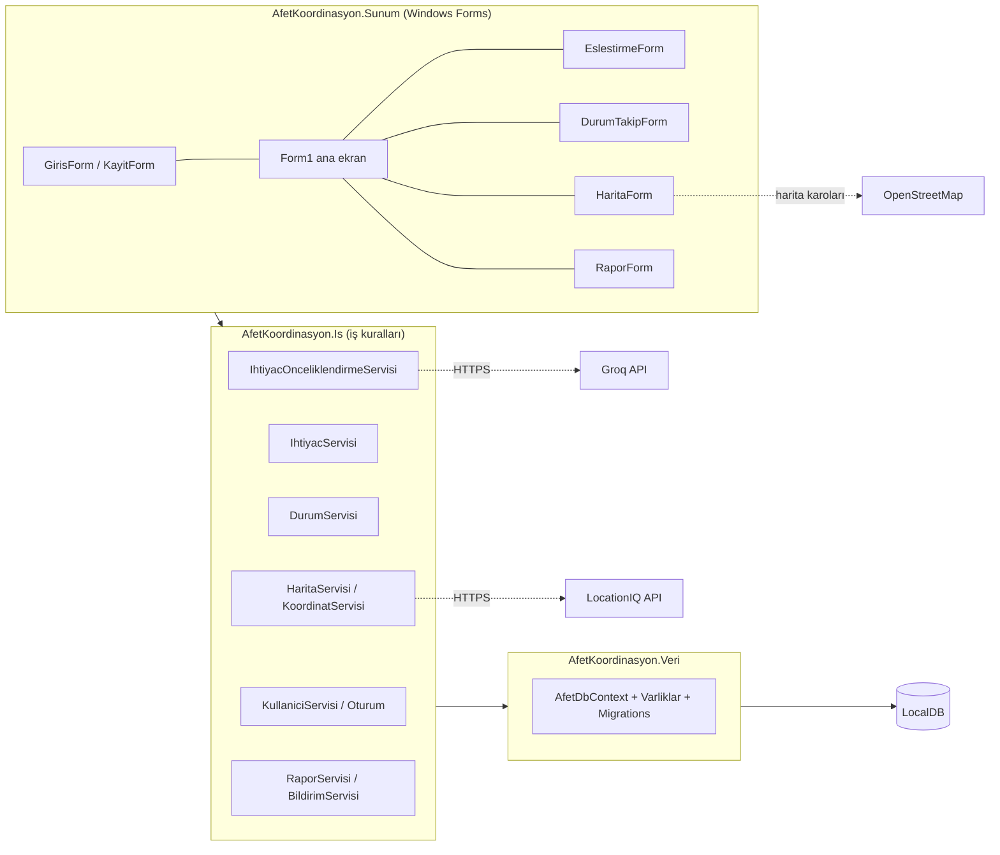
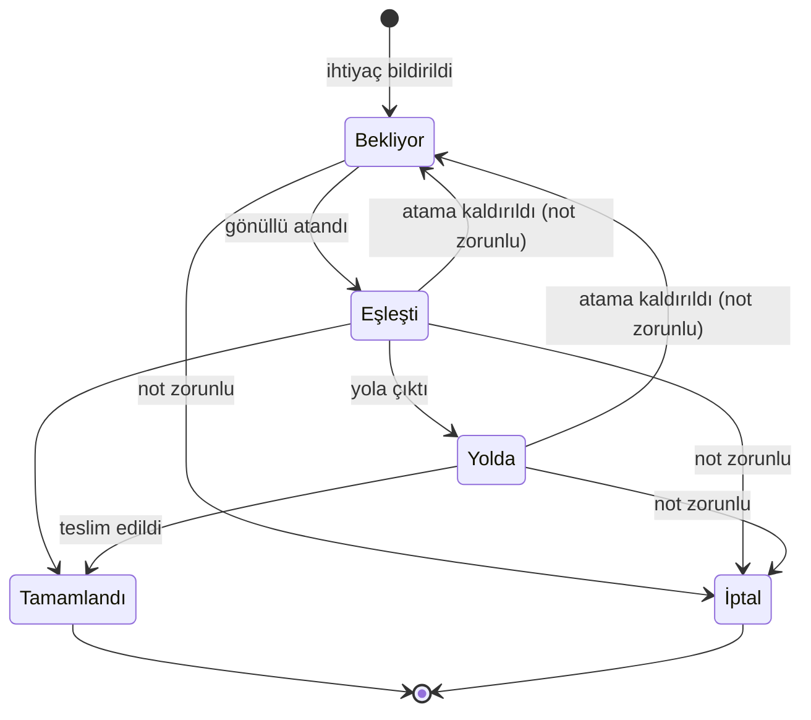

# Teknik Dokümantasyon

**Afet Sonrası İhtiyaç ve Gönüllü Koordinasyon Sistemi** (P13) · Beyzanur Rana Sansar
Kurulum ve kullanım için: [README.md](../README.md)

## İçindekiler
1. Genel bakış
2. Mimari
3. Modüller ve sorumlu sınıflar
4. Veri modeli
5. Durum makinesi
6. Dış servisler (API)
7. Güvenlik ve KVKK
8. Yapılandırma ve ortam değişkenleri
9. Veritabanı kurulumu ve migration'lar
10. Test
11. Dağıtım
12. Bilinen kısıtlar ve gelecek planı

---

## 1. Genel bakış
Uygulama, afet sonrasında ihtiyaç bildirimlerini toplar, koordinatörün bu ihtiyaçlara uygun gönüllüleri atamasını sağlar ve her ihtiyacın bildirimden teslime kadar durumunu izler. Masaüstü (Windows Forms) bir uygulamadır; veriler yerel SQL Server LocalDB veritabanında tutulur.

**Roller**
| Rol | Yapabildikleri |
|---|---|
| Afetzede | Kayıt, giriş, ihtiyaç bildirme, kendi ihtiyacına not ekleme |
| Gönüllü | Kayıt, giriş, ihtiyaçları görme |
| Koordinatör | Tüm işlemler: eşleştirme, durum değiştirme, iptal, silme, rapor, bildirimler |

## 2. Mimari
Projem Sunum, İş ve Veri olmak üzere üç katmandan oluşuyor. Formlarım (Sunum) doğrudan veritabanına gitmiyor; önce İş katmanındaki servisleri çağırıyor, servisler de Veri katmanı üzerinden veritabanına erişiyor (Form → Servis → Veritabanı). Bu yapıyı seçtim çünkü kod düzenli kalıyor, kurallar tek yerde duruyor, bir katman değişince diğerleri bozulmuyor ve kod test edilebiliyor.

**Katman kuralları**
- Sunum yalnızca İş katmanını çağırır. İstisna: varlık sınıfları (ör. `Ihtiyac`) veri taşımak için kullanılır.
- Yetki kontrolü İş katmanında yapılır (`Oturum.RolGerekli("Koordinator")`). Bir butonu gizlemek tek başına güvenlik sayılmaz.
- Bir ihtiyacın durumunu **yalnızca** `DurumServisi` değiştirir.

## 3. Modüller ve sorumlu sınıflar

| # | Modül | Açıklama | Sınıflar |
|---|---|---|---|
| 1 | Kullanıcı | Kullanıcılar kayıt olup giriş yapabiliyor ve rollerine (afetzede, gönüllü, koordinatör) göre farklı ekranlar görüyor. Parolalar şifrelenerek saklanıyor; 5 hatalı denemede hesap 15 dakika kilitleniyor. | `KullaniciServisi`, `Oturum`, `GirisForm`, `KayitForm` |
| 2 | İhtiyaç bildirimi | Kullanıcı ihtiyacını tür, açıklama, miktar, konum ve kategori bilgisiyle bildiriyor. Yeni ihtiyaç ilk olarak "Bekliyor" durumunda kaydediliyor. | `IhtiyacServisi`, `Form1` |
| 3 | Eşleştirme | Koordinatör, bekleyen bir ihtiyaca aynı bölgedeki müsait bir gönüllüyü atıyor. Bir gönüllü aynı anda sadece tek bir işte görev alabiliyor; bu kural hem kodda hem veritabanında kontrol ediliyor. | `EslesmeServisi`, `EslestirmeForm` |
| 4 | Durum takibi | Bir ihtiyaç Bekliyor → Eşleşti → Yolda → Tamamlandı sırasıyla ilerliyor ve gerekirse İptal edilebiliyor. Her durum değişikliği; kim yaptı, ne zaman ve neden bilgisiyle geçmişe kaydediliyor. | `DurumServisi`, `DurumTakipForm` |
| 5 | Yapay zekâ | Yapay zekâ, ihtiyacın açıklamasına bakarak kategori ve aciliyet (1–5) önerisi veriyor; son kararı kullanıcı veriyor. Açıklamadaki telefon, e-posta ve TC numarası yapay zekâya gönderilmeden maskeleniyor. Yapay zekâ çalışmazsa yedek kurallar devreye giriyor. | `IhtiyacOnceliklendirmeServisi` |
| 6 | Harita | Haritada her bölge, oradaki en acil duruma göre renkli bir işaretle gösteriliyor (kırmızı: kritik bekleyen, turuncu: bekleyen, mavi: süreçte); gönüllüler yeşil işaretle görünüyor. Bölgelerin koordinatları LocationIQ servisinden bir kez alınıp veritabanına kaydediliyor. | `HaritaServisi`, `KoordinatServisi`, `HaritaForm` |
| 7 | Durum raporu | Rapor, karşılanma oranını ve ihtiyaç sayılarını bölgeye ve kategoriye göre gösteriyor; sonuçlar grafikle görselleştiriliyor ve CSV dosyası olarak dışa aktarılabiliyor. | `RaporServisi`, `RaporForm` |
| 8 | Bildirim | 1 saatten uzun süredir gönüllü bekleyen kritik (aciliyet 4–5) ihtiyaçlar için koordinatöre Windows bildirimi gidiyor; bildirime tıklayınca Durum Takibi açılıyor. | `BildirimServisi`, `Form1` |
| – | Kurulum | Uygulama açılırken veritabanını oluşturur/günceller; hiç koordinatör yoksa ilk kurulum ekranını açar. | `KurulumServisi`, `VeritabaniKurulumu`, `Program` |

**Başlıca servis metotları**
| Servis | Metotlar |
|---|---|
| `KullaniciServisi` | `KayitOl`, `GirisYap`, `KoordinatorVarMi`, `IlkKoordinatoruOlustur` |
| `IhtiyacServisi` | `Listele`, `BekleyenleriListele`, `Ekle`, `Guncelle`, `Sil` (koordinatör) |
| `EslesmeServisi` | `BekleyenIhtiyaclariGetir`, `UygunGonulluleriGetir`, `Eslestir`, `Tamamla` (→ `DurumServisi`) |
| `DurumServisi` | `Ata`, `YolaCikti`, `Tamamla`, `AtamayiKaldir`, `IptalEt`, `NotEkle`, `TakipListesi`, `GecmisiGetir`, `GecisGecerliMi` |
| `IhtiyacOnceliklendirmeServisi` | `DegerlendirAsync`, `KisiselVeriMaskele` |
| `HaritaServisi` / `KoordinatServisi` | `BolgeOzetleri`, `EksikKoordinatlariTamamlaAsync`, `TumKoordinatlariYenidenAlAsync` |
| `RaporServisi` | `Olustur(gunSayisi)`, `OzetMetni`, `CsvOlustur` |
| `BildirimServisi` | `UzunSuredirBekleyenKritikler(esikDakika)` |

## 4. Veri modeli
ER diyagramı: [er-diyagrami.png](../er-diyagrami.png)

| Tablo | Önemli alanlar | Not |
|---|---|---|
| `Kullanicilar` | Id, AdSoyad, Email (benzersiz), ParolaHash, Rol, HataliGiris, KilitBitis | Parola düz metin olarak saklanmaz (BCrypt) |
| `Ihtiyac` | IhtiyacId, Tur, Aciklama, Miktar, Tarih, AciliyetSkoru (1–5, boş olabilir), AiGerekce, KonumId, KategoriId, DurumId, KullaniciId, SatirSurumu | `SatirSurumu` = rowversion (eşzamanlılık kontrolü) |
| `Kategori` | Id, Ad | Gıda, Su, Barınma, Sağlık, Giyim, Hijyen |
| `Konum` | KonumId, Il, Ilce, Mahalle, Enlem, Boylam | Koordinatlar LocationIQ'dan bir kez alınır |
| `Durum` | DurumId, Ad | Bekliyor, Eşleşti, Yolda, Tamamlandı, İptal |
| `Gonullu` | GonulluId, AdSoyad, Telefon, Beceri, MusaitMi, KonumId | |
| `Eslesme` | EslesmeId, IhtiyacId, GonulluId, Tarih, Aktif, BitisTarihi | Silinmez, pasif yapılır |
| `DurumGecmisi` | DurumGecmisiId, IhtiyacId, EskiDurum, YeniDurum, Tarih, KullaniciId, Not | Sadece eklenir (denetim izi) |

**Veritabanı seviyesindeki kurallar**
- `UX_Eslesme_AktifIhtiyac`: bir ihtiyacın en fazla **bir** aktif eşleşmesi olabilir (`WHERE Aktif = 1` filtreli benzersiz indeks).
- `UX_Eslesme_AktifGonullu`: bir gönüllünün en fazla **bir** aktif eşleşmesi olabilir.
- `Kullanicilar.Email` benzersizdir.

## 5. Durum makinesi

- İzin verilmeyen geçişler (ör. Bekliyor → Tamamlandı) reddedilir ve geçmişe yazılmaz.
- Tamamlandı, İptal ve atamanın kaldırılmasında aktif eşleşme kapatılır, gönüllü yeniden müsait olur.
- İptal ve atamayı kaldırma için 5–500 karakterlik not zorunludur.
- Her işlem tek `SaveChanges` ile kaydedilir: ya hepsi kaydedilir ya hiçbiri.

## 6. Dış servisler (API)

### 6.1 LocationIQ (koordinat bulma)
| | |
|---|---|
| Uç nokta | `GET https://eu1.locationiq.com/v1/search` |
| Kimlik doğrulama | `key` parametresi; değer `LOCATIONIQ_API_KEY` ortam değişkeninden okunur |
| Sorgu | Önce yapılandırılmış arama (`city`, `state`, `country=Türkiye`), bulunamazsa serbest metin |
| Doğrulama | Sonuç Türkiye sınırları dışındaysa (enlem 35.8–42.2, boylam 25.6–44.9) reddedilir |
| Limit | Ücretsiz plan: saniyede 2, günde 5000 istek → istekler arasında 600 ms beklenir |
| Hata yönetimi | 401/403: anahtar hatası mesajı; 429 ve sunucu hataları: artan bekleme ile en fazla 3 deneme; zaman aşımı 10 sn |
| Önbellek | Bulunan koordinat `Konum` tablosuna yazılır; aynı yer için tekrar istek atılmaz |

### 6.2 Groq (yapay zekâ önerisi)
| | |
|---|---|
| Uç nokta | `POST https://api.groq.com/openai/v1/chat/completions` (OpenAI uyumlu) |
| Kimlik doğrulama | `Authorization: Bearer <GROQ_API_KEY>` |
| Model | `openai/gpt-oss-120b` (`GROQ_MODEL` ortam değişkeniyle değiştirilebilir) |
| Parametreler | `temperature: 0`, `reasoning_effort: low`, `max_completion_tokens: 1024`, `response_format: json_object` |
| Beklenen cevap | `{"kategori": "...", "aciliyet": 1-5, "gerekce": "..."}` |
| Doğrulama | Kategori listede olmalı, aciliyet 1–5 tam sayı olmalı, gerekçe en fazla 300 karakter; geçersizse bir kez daha sorulur |
| Hata yönetimi | 401/403 anahtar hatası; 429 ve 5xx için en fazla 2 deneme; zaman aşımı 20 sn; başarısızlıkta kural tabanlı yedek |
| KVKK | Telefon, e-posta ve TC numarası gönderilmeden önce maskelenir |

### 6.3 OpenStreetMap (harita karoları)
GMap.NET ile gösterilir; karolar yerel önbellekte de tutulur (`ServerAndCache`). OSM kullanım kuralı gereği uygulamaya özel bir `User-Agent` gönderilir; haritada telif satırı gösterilir.

## 7. Güvenlik ve KVKK
- **Parolalar:** BCrypt ile özetlenir; en az 8 karakter. 5 hatalı denemede hesap 15 dakika kilitlenir; hata mesajı e-postanın kayıtlı olup olmadığını belli etmez.
- **Oturum:** 30 dakika işlem yapılmazsa sona erer.
- **Yetki:** Kritik işlemler İş katmanında `Oturum.RolGerekli("Koordinator")` ile korunur. Koordinatöre özel butonlar diğer rollerde gizlenir.
- **Varsayılan hesap yok:** İlk koordinatör, ilk çalıştırmada kurulum ekranından oluşturulur. Koordinatör varken bu yol kapanır.
- **Gizli anahtarlar:** API anahtarları kodda ve depoda yoktur; ortam değişkenlerinden okunur. Örnek betik (`ortam-degiskenleri-ornek.ps1`) yalnızca yer tutucu içerir; doldurulmuş kopyası `.gitignore`'dadır. Bağlantı dizesi parola içermez (Windows kimlik doğrulaması).
- **KVKK:** Örnek ve test verileri uydurmadır. Yapay zekâya kişisel veri maskelenerek gönderilir. CSV raporunda iletişim bilgisi yoktur.
- **Eşzamanlılık:** İki koordinatör aynı kaydı aynı anda değiştirirse ikincisi uyarı alır (rowversion).

## 8. Yapılandırma ve ortam değişkenleri
| Ayar | Yer | Varsayılan |
|---|---|---|
| Bağlantı dizesi `AfetDb` | `AfetKoordinasyon.Sunum\App.config` | `Server=(localdb)\MSSQLLocalDB;Database=AfetKoordinasyonDb;Trusted_Connection=True;` |
| Test bağlantı dizesi | `AfetKoordinasyon.Testler\App.config` | `...Database=AfetKoordinasyonTestDb...` |
| `LOCATIONIQ_API_KEY` | Windows kullanıcı ortam değişkeni | yok (isteğe bağlı) |
| `GROQ_API_KEY` | Windows kullanıcı ortam değişkeni | yok (isteğe bağlı) |
| `GROQ_MODEL` | Windows kullanıcı ortam değişkeni | `openai/gpt-oss-120b` |

## 9. Veritabanı kurulumu ve migration'lar
Uygulama açılırken `KurulumServisi.VeritabaniniHazirla()` → `VeritabaniKurulumu.Hazirla()` çalışır: uygulanmamış migration varsa `DbMigrator.Update()` ile uygular; veritabanı yoksa oluşturur ve `Seed` ile örnek verileri ekler. Eksik migration yoksa hiçbir şey yapmaz.

| Migration | Ne yaptı |
|---|---|
| IlkSema | Konum, Durum, Gönüllü, İhtiyaç, Eşleşme tabloları |
| KullaniciEklendi | Kullanıcılar tablosu |
| KategoriEklendi | Kategori tablosu ve ilişki |
| IhtiyacKullaniciEklendi | İhtiyacı bildiren kullanıcı |
| MusaitMiEkle | Gönüllü müsaitliği |
| KonumKoordinatEklendi | Enlem/Boylam |
| IhtiyacAciliyetEklendi | AciliyetSkoru, AiGerekce |
| DurumTakibiEklendi | DurumGecmisi, Eslesme.Aktif/BitisTarihi, SatirSurumu, benzersiz indeksler |
| VeriTutarliligiDuzeltme | Eski Seed kaynaklı tutarsız kayıtların düzeltilmesi |

Geliştirici yeni migration eklerken: Package Manager Console → `Add-Migration Ad -ProjectName AfetKoordinasyon.Veri`, sonra `Update-Database -ProjectName AfetKoordinasyon.Veri` (ya da uygulamayı çalıştırmak yeterli).

## 10. Test
- **AfetKoordinasyon.Testler** (MSTest): 59 test.
  - Birim: durum makinesi, yetki ve not kuralları, rapor/bildirim metinleri, KVKK maskeleme, yapay zekâ çıktı doğrulama, kural tabanlı yedek.
  - Entegrasyon (gerçek LocalDB, ayrı test veritabanı): atama → yola çıkış → tamamlama, çift atama (kod + indeks), iptal, eşzamanlılık.
- Testler dış API'lere istek atmaz.
- Arayüz (formlar) elle test edilir.

## 11. Dağıtım
- **Yöntem:** Release derlemesi + `bin\Release` klasörünün ZIP olarak paylaşılması (xcopy dağıtımı). Kurulum programı gerekmez.
- **Hedef makine:** Windows 10/11, .NET Framework 4.8, SQL Server Express LocalDB. API anahtarları isteğe bağlıdır.
- **Değerlendirilen alternatifler:** ClickOnce (Visual Studio'dan yayımlama, otomatik güncelleme), MSI kurulum paketi. Ders projesi için ZIP dağıtımı yeterli görüldü.
- **Olası dağıtım sorunları ve önlemleri:**
  | Sorun | Önlem |
  |---|---|
  | Hedefte LocalDB yok | Açılışta anlaşılır "Veritabanı hazırlanamadı" mesajı ve README'de kurulum adımı |
  | Veritabanı yok / eski | Açılışta otomatik migration |
  | Koordinatör hesabı yok | İlk kurulum ekranı |
  | API anahtarı yok | Uygulama çalışmaya devam eder (yedek kurallar, kayıtlı koordinatlar) |
  | Sadece exe kopyalanır | README'de tüm `Release` klasörünün paylaşılması gerektiği yazılı |

## 12. Bilinen kısıtlar ve gelecek planı
- Kural tabanlı yedek, ekli kelimelerde (ör. "bebeğim") anahtar kelimeyi yakalamayabilir.
- Formlar için otomatik arayüz testi yok.
- Uygulama tek bilgisayarda (LocalDB) çalışır; birden çok koordinatörün farklı bilgisayarlardan çalışması için ortak bir SQL Server gerekir. Bağlantı dizesi değiştirilerek yapılabilir.
- **Gelecek:** Türkiye'deki tüm il ve ilçelerin listeden seçilmesi; gönüllüler için mobil uygulama.
